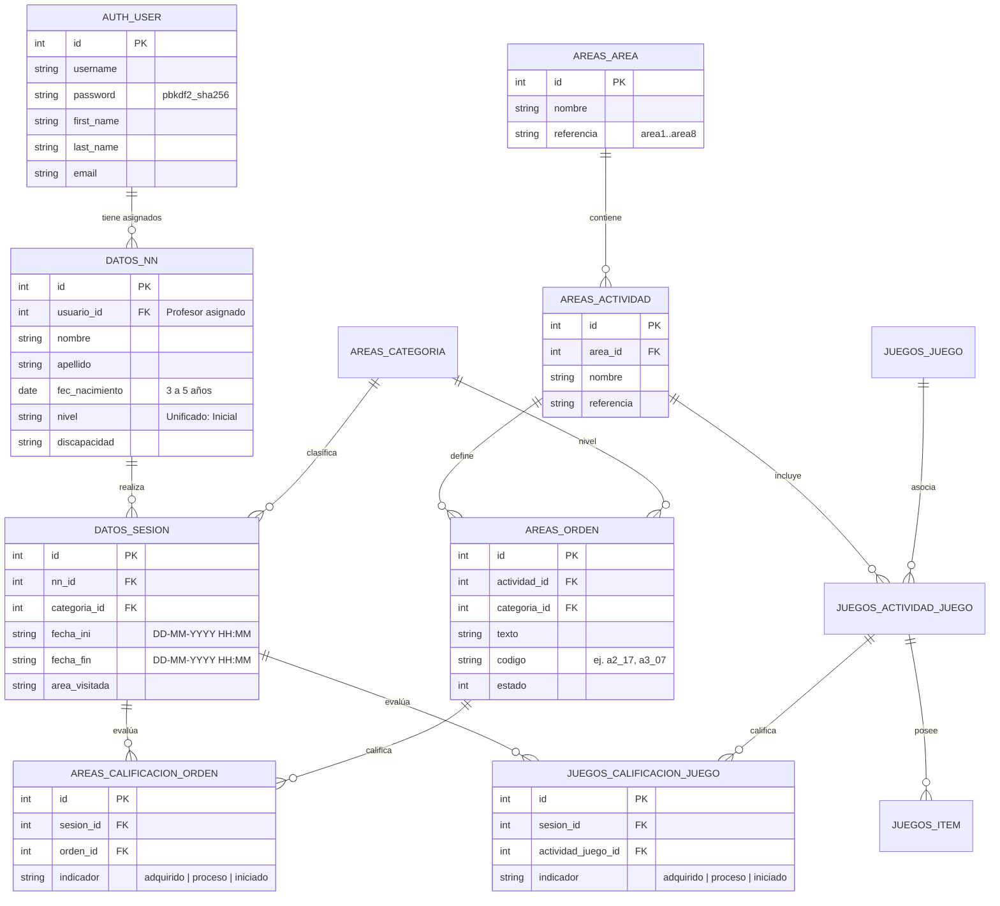

# Ecosistema Raspberry Pi: Django, PostgreSQL y Hardware Arduino

Este documento describe la arquitectura, servicios, base de datos pedagógica y protocolo de hardware alojados en la **Raspberry Pi** (`/home/pi` y `/home/pi/proyectos`), así como su integración con el backend moderno de Inteligencia Artificial (**FastAPI**) y la aplicación interactiva (**Godot 4**).

---

## 1. Estructura de Archivos en la Raspberry Pi

En el sistema de archivos de la tarjeta SD de la Raspberry Pi (`/home/pi`), el entorno se compone de los siguientes elementos:

```
/home/pi/
├── backup_tesis.sql         # Volcado PostgreSQL 10.3 con el catálogo pedagógico (base_tesis)
├── server.py                # Servidor TCP (:41798) puente hacia el Arduino por USB Serial
├── battery.py               # Monitor de voltaje y carga para Raspi UPS Hat vía I2C (SMBus 0x36)
├── test.py                  # Script de diagnóstico de pines físicos GPIO (BOARD 7, 11, 13)
├── run.sh                   # Ejecución directa de server.py
├── reiniciar.sh             # Reinicia el servicio systemd felpudoserver.service
├── ver.sh                   # Visualización en vivo de logs (tail -f /home/pi/logs/tcpserver.log)
├── logs/
│   └── tcpserver.log*       # Historial rotativo de comunicación TCP ↔ Serial Arduino
└── proyectos/
    ├── entorno/             # Virtualenv (Python 3.5, Django 2.2.7, DRF 3.10.3, xhtml2pdf, ReportLab)
    └── tesis/               # Proyecto Django REST (Gestión de profesores, alumnos, sesiones y reportes)
        ├── manage.py
        ├── tesis/           # Configuración central (settings.py, urls.py, wsgi.py)
        ├── apps/
        │   ├── datos/       # Modelos NN (Alumnos) y SESION
        │   ├── areas/       # Modelos AREA, ACTIVIDAD, CATEGORIA, ORDEN, CALIFICACION_ORDEN
        │   ├── juegos/      # Modelos JUEGO, ACTIVIDAD_JUEGO, ITEM, CALIFICACION_JUEGO
        │   ├── servicios/   # API REST y Serializers (DRF + TokenAuth)
        │   ├── reportes/    # Generación de informes por alumno y sesión
        │   └── utilidades/  # Renderizado HTML y exportación a PDF (xhtml2pdf / Yattag)
        ├── templates/aux/   # Plantillas HTML generadas por sesión (ej. sesion1.html)
        └── static/css/      # Hojas de estilo para reportes PDF (vertical y horizontal)
```

---

## 2. Servidor de Hardware y Protocolo Arduino (`server.py`)

El peluche robotizado **Felpudo** cuenta con sensores de toque y actuadores controlados por un **Arduino** conectado por puerto serial USB (`/dev/ttyUSB*` a `9600 baudios`).

### 2.1 Servicio del Sistema (`felpudoserver.service`)
- **Host / Puerto TCP:** `192.168.1.200:41798`
- **Funcionamiento:** Al conectarse un cliente por socket TCP, `server.py` envía `"BIENVENIDO\n"` y abre dos hilos:
  1. `clientthread`: Todo comando recibido por red se retransmite directamente al puerto serial del Arduino (`arduino.write(data)`).
  2. `readFromArduino`: Escucha respuestas de 4 bytes desde el Arduino (`len(txt) == 4`) cuando el niño presiona un sensor del peluche y las reenvía al cliente TCP.

### 2.2 Tabla del Protocolo Serial del Arduino
A partir del código fuente y los registros de operación en `/home/pi/logs/tcpserver.log`, el protocolo de comandos entre el software y el Arduino es el siguiente:

| Categoría | Código Enviado (TCP → Arduino) | Significado / Acción en el Peluche Felpudo | Respuesta del Sensor (Arduino → TCP) |
| :--- | :---: | :--- | :---: |
| **Selección de Área** | `A1` | Activa modo Área 1 (Socialización) | — |
| | `A2` | Activa modo Área 2 (Aspectos de Lateralidad) | — |
| | `A3` | Activa modo Área 3 (Reconocimiento de Partes del Cuerpo) | — |
| **Partes del Cuerpo** | `CA0`, `CA2`, `CA3` | Instrucción / estímulo en **Cabeza** | `TCA\n` *(Tocó Cabeza)* |
| | `BR0`, `BR1`, `BR3` | Instrucción / estímulo en **Brazos / Hombros** | — |
| | `MD4` | Instrucción / estímulo en **Mano Derecha** | `TMD\n` *(Tocó Mano Derecha)* |
| | `MI5` | Instrucción / estímulo en **Mano Izquierda** | `TMI\n` *(Tocó Mano Izquierda)* |
| | `OD2` | Instrucción / estímulo en **Oreja Derecha** | — |
| | `OI1` | Instrucción / estímulo en **Oreja Izquierda** | `TOI\n` *(Tocó Oreja Izquierda)* |
| | `PD5` | Instrucción / estímulo en **Pierna Derecha** | — |
| | `PI1`, `PI2`, `PI4` | Instrucción / estímulo en **Pierna Izquierda** | `TPI\n` *(Tocó Pierna Izquierda)* |
| **Sensores** | `TT` | Habilita espera de lectura de toque en el peluche | `T__\n` (4 bytes) |
| **Retroalimentación** | `CC` | **Celebración / Acierto** (El niño completó la actividad) | — |
| | `NA` | **Intento Fallido / Tiempo Agotado** | — |

> [!TIP]
> **Modo Tolerante a Fallos en FastAPI:** El nuevo backend envía estos mismos códigos (`A2`, `A3`, `MD4`, `MI5`, `CA3`, `OD2`, `BR1`, `CC`, `NA`) en modo asíncrono (*fire-and-forget* con timeout de 150 ms). Si el Arduino no está conectado físicamente durante una sesión, el sistema registra el evento en consola y continúa sin bloquear el juego ni la cámara.

---

## 3. Monitoreo de Energía (`battery.py`)

La Raspberry Pi utiliza un módulo **Raspi UPS Hat** conectado por el bus `I2C-1` (`/dev/i2c-1`, dirección hexadecimal `0x36`):
- **Registro `2`:** Calcula el voltaje en voltios (`swapped * 1.25 / 1000 / 16`).
- **Registro `4`:** Calcula el porcentaje de batería restante (`swapped / 256`), emitiendo alertas cuando es `< 20%` (`Battery LOW`) o `100%` (`Battery FULL`).

---

## 4. Base de Datos Pedagógica (`base_tesis` en PostgreSQL)

El sistema utiliza PostgreSQL (base de datos `base_tesis`, usuario `uarise`). Todos los estudiantes (niños de **3 a 5 años**) pertenecen a un **único nivel estándar (`Inicial`)** y se distinguen por el **profesor (`auth_user`)** al que están asignados.

### 4.1 Diagrama Entidad-Relación



### 4.2 Catálogo Pedagógico en `backup_tesis.sql`
El volcado contiene **8 áreas**, **13 actividades**, **279 órdenes** y **272 ítems de juego**:

| ID Área | Referencia | Nombre del Área | Relación con el Nuevo Sistema (IA) |
| :---: | :---: | :--- | :--- |
| `1` | `area1` | Socialización | Saludos, levantar ambas manos / juntar palmas (`a1_05`) |
| `2` | `area2` | Aspectos de Lateralidad | **Actividad Corporal (YOLO-Pose):** Mano derecha (`a2_17`), Mano izquierda (`a2_18`), Orejas (`a2_10`, `a2_12`) |
| `3` | `area3` | Reconocimiento de las Partes del Cuerpo | **Actividad Corporal (YOLO-Pose):** Tocar cabeza (`a3_07`), brazos/hombros (`a3_05`, `a3_08`), torso/pecho/cintura |
| `4`–`8` | `area4`–`area8` | Colores, Emociones, Normas, Secuencias y Números | **Actividad de Pictogramas (ONNX + Whisper + LLM):** Reconocimiento visual de tarjetas y diálogo guiado por voz |

---

## 5. Endpoints del Servidor Django (`proyectos/tesis`)

El servidor Django expone sus servicios bajo los prefijos `/servicios/` y `/reportes/`:

### 5.1 Autenticación y Profesores
- `POST /servicios/api-token-auth/` — Valida `username` y `password`, devuelve `{"token", "id", "name"}`.
- `POST /servicios/validarUsuario/` — Verifica existencia de correo electrónico.
- `POST /servicios/cambiarClave/` — Actualiza contraseña del docente.
- `POST /servicios/addProfesor/` y `GET|POST /servicios/updateProfesor/<id>/` — Registro y edición de docentes.

### 5.2 Alumnos (`NN` - Niños de 3 a 5 años)
- `GET /servicios/listAlumnos/<id_profesor>/` — Lista los alumnos asociados exclusivamente al profesor indicado.
- `POST /servicios/addAlumno/` — Registra un nuevo alumno asignado al profesor.
- `GET|POST /servicios/updateAlumno/<id>/` y `POST /servicios/deleteAlumno/<id>/` — Actualización y baja de alumno.

### 5.3 Sesiones y Calificaciones
- `POST /servicios/addSesion/` — Inicia sesión (`nn`, `categoria`).
- `POST /servicios/updateSesion/<id>/` — Finaliza sesión actualizando `fecha_fin` y `area_visitada`.
- `GET /servicios/listSesiones/<id_nn>/` — Historial de sesiones del alumno.
- `POST /servicios/addCalificacion_Orden/` — Guarda evaluación de una orden corporal (`orden`, `sesion`, `indicador`).
- `POST /servicios/addCalificacion_Juego/` — Guarda evaluación de un juego/pictograma (`actividad_juego`, `sesion`, `indicador`).

### 5.4 Reportes
- `GET /reportes/sesion/<id_nna>/<id_sesion>/` — Genera el reporte individual en HTML (`templates/aux/sesion<id>.html`) y PDF con los indicadores `adquirido`, `proceso` o `iniciado`.
